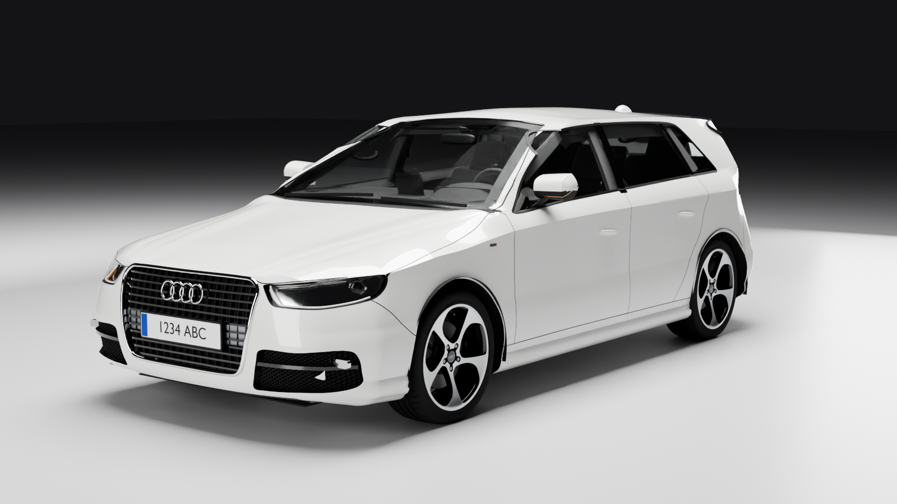

# Audi A3 Sportback 8V · 2.0 TDI 150 CV S tronic S line — Digital Twin

Réplica 3D procedural de un **Audi A3 Sportback 8V pre-restyling (MY2013–2016, tipo 8VA)**,
2.0 TDI 110 kW S tronic, tracción delantera, acabado **S line**, blanco, interior de cuero
negro, volante de cuatro radios, MMI con pantalla emergente, climatizador bizona y llantas
Audi exclusive 18" *5-arm rotor* negro brillante diamantadas.

Todo el modelo se **genera por código** con Blender 5.2 usado como módulo de Python (`bpy`):
no hay mallas hechas a mano ni texturas descargadas (las texturas también se generan por código
y se hornean a imagen para viajar en el GLB). Cada cota relevante está en el código con su
origen (C = confirmada, S = fuente secundaria, E = estimada).

**v0.2**: frontal, laterales y zaga re-medidos con calibración de cámara sub-píxel y
triangulación multi-foto; carrocería dividida en paneles reales; motor 2.0 TDI, suspensiones,
escape y maletero; texturas horneadas; visor con HUD y vista despiezada. Detalle en
[`docs/STATUS.md`](docs/STATUS.md).



**Visor web (GitHub Pages):** `https://alvarodesigns34.github.io/audi/` — se publica desde la
rama `main`, carpeta `/docs` (Settings → Pages → *Deploy from a branch* → `main` / `/docs`).
En iPhone/iPad, el enlace AR del visor abre `docs/models/a3_sportback_8v.usdz` en Vista Rápida.

## Uso rápido

```bash
tools/setup_env.sh                                   # crea /opt/bpyenv con bpy 5.2
PY=/opt/bpyenv/bin/python

# coche completo + renders de verificación
$PY tools/run.py --views front34,rear34,side_r,cockpit --out out/renders

# todo lo publicado en GitHub Pages: GLB + USDZ completos y renders de docs/renders
tools/publish.sh

# vista despiezada / vano motor en render
$PY tools/run.py --views front34 --explode 1.0 --tag ex_
$PY tools/run.py --views bay --hide "^Body_Hood$|^Body_Cowl$|^Glass_Windscreen"

# visor web (Three.js) en local
cd docs && python3 -m http.server 8000   # abrir http://localhost:8000
```

`--parts body,glass,...` construye solo un subconjunto; `--clay` pinta la carrocería en gris
para revisar superficies; `tools/skin_preview.py` renderiza solo la piel en arcilla oscura. La carrocería (booleanas exactas, ~3 min) se cachea en
`out/cache/` y se reutiliza mientras no cambien sus fuentes.

## Cómo se ha construido (y validado)

1. **Datos** — `src/a3/spec.py`: longitud 4310, anchura 1785 (1966 con retrovisores), altura
   1425 − 15 (suspensión deportiva S line), batalla 2636, vías 1535/1506, voladizos 869/805,
   neumático 225/40 R18, llanta 8J×18 ET46, frenos 312×25 / 272×10.
2. **Carrocería** — `src/a3/body/`:
   * Superficie por secciones transversales entre dos planos de corte, gobernada por líneas
     características (perfil superior/inferior, línea *tornado*, cintura, borde del techo,
     etc.) en tablas en mm (`lines.py`), con tangencia y aristas vivas controladas.
   * Morro y zaga cerrados con superficies "perfil lateral × planta" (`surface.EndCap`), que
     no pueden plegarse y empalman con la sección de corte.
   * Espesor de chapa, pasos de rueda, huecos de lunas, juntas de puertas/capó/portón/
     paragolpes, tapa de combustible (lado derecho), parrilla, faros, tomas, pilotos y
     difusor cortados con **booleanas exactas** sobre la piel (`openings.py`).
3. **Validación fotogramétrica** — `tools/make_match.py` + `tools/rim_edge.py` detectan el
   contorno de las llantas en fotos reales (Wikimedia Commons, `tools/fetch_references.sh`) y
   `tools/camera_match.py` calibra la cámara (< 1 px). `tools/triangulate.py` triangula
   puntos característicos vistos en varias fotos (con altura de carrocería por coche),
   `tools/raycast_photo.py` los proyecta sobre la piel, `tools/silhouette.py` y
   `tools/overlay.py` superponen silueta, contornos y render sobre cada foto.
4. **Piezas** — `src/a3/exterior/` (frontal, faros, zaga, retrovisores, molduras, bajos,
   `chassis.py` suspensiones/dirección/escape, `engine.py` 2.0 TDI EA288 + DQ250),
   `src/a3/wheels/` (llanta, neumático con dibujo y marcaje, frenos, buje) e
   `src/a3/interior/` (salpicadero, salidas de aire, cuadro, MMI, climatizador, volante de
   4 radios, consola S tronic, asientos S line, paneles de puerta, guarnecidos, pedales,
   maletero).
5. **Montaje** — `src/a3/body/panels.py` divide el casco en paneles reales y
   `src/a3/groups.py` organiza todo en 45 grupos con extras glTF (`group`, `label`,
   `explode`) que usa el visor para la vista despiezada.
6. **Materiales** — `src/a3/core/materials.py` (PBR) + `src/a3/core/textures.py` (texturas
   generadas por código y horneadas a imagen) + `src/a3/core/uv.py` (UV en metros).

## Sistema de coordenadas

ISO 8855: +X adelante, +Y izquierda, +Z arriba, metros; origen en el suelo, en el centro del
eje delantero. Volante a la izquierda. Ver `docs/CONVENTIONS.md`.

## Estado, limitaciones y traspaso

* `docs/STATUS.md`: qué hay en v0.2, precisión por zona, errores conocidos, decisiones y
  preguntas abiertas al propietario.
* `docs/HANDOFF.md`: mapa del repositorio, herramientas, lecciones aprendidas y el prompt
  para continuar en una sesión nueva.
* `docs/CONVENTIONS.md`: coordenadas, estructura de piezas, materiales, texturas y grupos.

El modelo sigue siendo una base: queda muchísimo por mejorar en formas, detalle y piezas.
